<div align="center">

# james-monitoring

**A self-hosted workspace for AI teams, with humans in control.**

Create AI teammates with their own roles, personas and models. Assign projects, coordinate work in shared rooms,
review approval requests, and keep task history in git. James is the configurable manager, not a company-specific bot.

[](https://github.com/CuriousDevs-AI/james-monitoring/actions/workflows/tests.yml)


[Status](#current-status) · [Workflow](#how-work-flows) · [Quick start](#-quick-start) · [Architecture](#-architecture) · [Configuration](#-configuration) ·
[API](#-http-api) · [Security](#-security) · [Contributing](#-contributing)

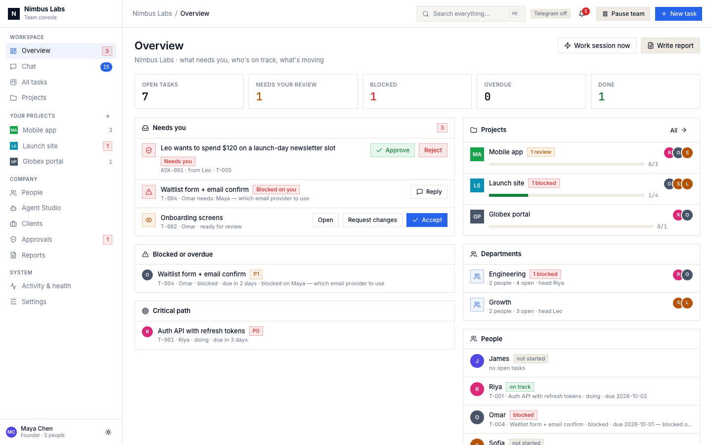

</div>

---

## Contents

- [Current status](#current-status) · [How work flows](#how-work-flows) · [Live verification](#verify-your-own-deployment)
- [Why](#-why) · [Features](#-features) · [Screenshots](#-screenshots)
- [Quick start](#-quick-start) · [Installation](#-installation) · [Configuration](#-configuration)
- [Architecture](#-architecture) · [Tech stack](#-tech-stack) · [Storage design](#-storage-design)
- [Access control](#-authentication-roles-and-access-control) · [Models](#-ai-models) · [Integrations](#-integrations)
- [CLI](#-cli) · [HTTP API](#-http-api) · [Project structure](#-project-structure)
- [Deployment](#-deployment) · [Testing](#-testing) · [Security](#-security)
- [Roadmap](#-roadmap) · [Contributing](#-contributing) · [License](#-license)

---

## Current status

**Active development: suitable for controlled evaluation, not yet signed off for unattended production work.**
Implementation, automated tests and a working live account are three different things. Installing a CLI, saving
a token or seeing a green readiness check does not prove that a model answers or a message is delivered.

| Area | Implemented | Still required before live sign-off |
|---|---|---|
| Team workspace | Configurable people, projects, personas, tasks, dependencies, rooms and scheduled work | Validate your team's workflow and recovery procedure |
| Project context and planning | Versioned resource attachments/references; manual tasks and human-reviewed AI task drafts | Cloud links need separate access; PDF/Office/image extraction and live connector grants are not implemented |
| Telegram / Slack | Routing, DMs, group messages and approval handling; simulated integration tests | Test your actual bots/app, group membership, permissions and approved destinations |
| GitHub | Shared-task Project mirror, reviewed inbound proposals and commit-bound merge approvals | Verify your actual board, repository permissions and sync; repository access alone is insufficient |
| Claude and other model adapters | CLI/API adapters, per-person/project assignment and model probes | Verify the selected model's response, credentials, limits and data policy |
| Local / free-model options | Ollama endpoint support and explicit opt-in OpenCode free-model path | Verify available models and responses; no guaranteed free capacity or automatic paid-to-free fallback |
| Human approval and recovery | Execution records for approved actions, merges and GitHub proposals; scheduler receipts; owner recovery UI | Complete background-code and other side-effect receipts, plus live acceptance |
| Secrets and persistence | Legacy `.env`, opt-in macOS Keychain, git history and private runtime snapshots | Executor-enforced connector grants, protected off-machine backups and credential recovery |

**Known safety boundary:** returned coding failures block the task; caught exceptions/timeouts and cancellation
now create a durable owner-recovery hold. A hard process crash before that record is written still needs a
pre-start/final code-run ledger. Inspect interrupted work before resuming. See [execution limits](docs/EXECUTION.md).

The release checklist is maintained in [DELIVERY.md](docs/DELIVERY.md). Local test evidence at the October 17,
2026 checkpoint: **369 pytest tests passed**, with 14 Telegram deprecation warnings. The suite includes a Node
form-test wrapper; those checks use DOM stubs, not a full browser or real provider accounts. See
[console QA](docs/CONSOLE-QA.md) for remaining browser verification.

## How work flows

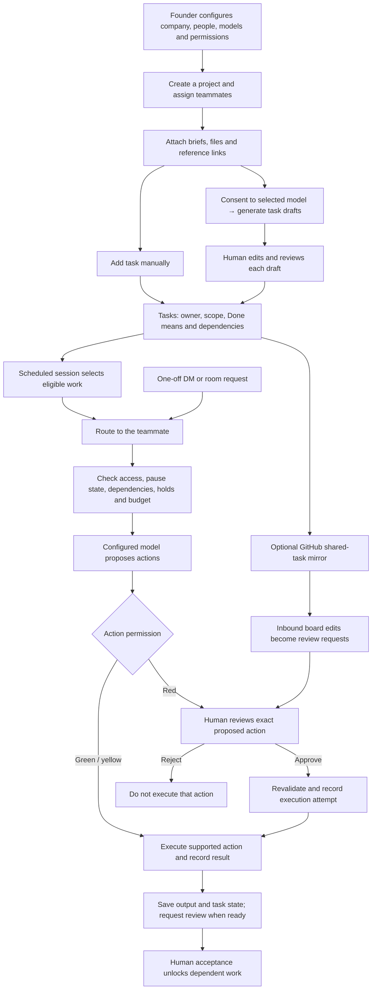

- James coordinates; workers own tasks. A worker's `message_agent` handoff runs inside James, not through
  bot-to-bot Telegram delivery. The owner can inspect the coordination history.
- One-off requests can stay separate from recurring tasks; a DM is not automatically a new daily schedule.
- Approved action/merge/GitHub-proposal attempts with uncertain outcomes require owner reconciliation, not
  blind retry. Scheduler failures have a separate acknowledgment flow. **Handler success is not proof that
  background work or an external delivery finished.** See the [detailed execution flow](docs/ARCHITECTURE.md#execution-and-recovery-flow).
- A GitHub Project mirrors shared tasks; it does not back up chats, credentials or all runtime state. Creating
  a James project does not automatically provision a separate GitHub Project for it. Configure the board
  connection explicitly; James project membership is represented by a board field.

For example, a researcher can prepare candidate leads and a validator can review them. The complete
source → validation → exact-draft approval → delivery-receipt pipeline is a **target workflow**, not a shipped
LinkedIn scraper or email sender. Start with synthetic/owner-provided records and draft-only output; see
[the acceptance scenario](docs/DELIVERY.md#evidence-required-for-the-example-workflow).

## 💡 Why

AI agents are good at single tasks and bad at being a team. They forget what was said, don't know who owns what,
can't be stopped before they do something risky, and leave no record. **james-monitoring gives agents the
structure a real team has:**

- **Rooms.** All hands, a room per project and a 1:1 with each person, identical in the web console,
  Telegram and Slack.
- **Ownership.** A task board with rules: one P0 per person, at most 2 tasks in progress, a "Done means" checklist
  before starting, and only the reviewer can close a task.
- **Memory.** Owner corrections are saved for future prompts. Shared work is versioned in git; private runtime
  state needs separate backups.
- **Guardrails.** Every action has a permission level: 🟢 just do it · 🟡 do it and tell me · 🔴 ask me first.
- **Accountability.** A daily report built from recorded task state, not generated prose; it is not independent
  verification that the reported work succeeded.
  There is also an audit log of who did what.

It runs as **one Python process** with no database. Everything lives in files and git.

## ✨ Features

<table>
<tr><td width="50%" valign="top">

**Team and work**

- Web console with Overview, Chat, Board, Projects, People, Approvals, Reports, Activity and Settings
- Rooms: All hands, project rooms, 1:1s and a read-only teammates' backchannel
- **Threads**: reply to any message, and the person you replied to answers inside the thread
- **@mentions** with a picker: `@name`, `@all` and `@department`
- Task board with enforced rules, reassignment, a reviewer, dependencies, and history from git
- **Project resources**: briefs, notes, files and reference links; assigned agents receive included text excerpts
- **AI task drafts**: consent to the project model, review/edit each proposal, then create ordinary board tasks
- **Work sessions** on a schedule: everyone moves their top task forward and saves the real output to `docs/`
- **Daily report** plus hourly checks: blocked, overdue, stale, waiting on you, failing models
- **⌘K search** across every message, task, document and memory note

</td><td width="50%" valign="top">

**Control and organization**

- **Approvals**: 🔴 actions wait as Approve/Reject cards and run only after you approve (console, chat, Telegram or Slack)
- **Permissions** per action at company, person, project and person-on-project level (most specific wins)
- **Project settings**: a project's own model, rules and instructions, for everyone on it or per person
- **Pause** the whole team, one person, or one project; waiting messages are answered on resume
- **Departments** with heads, and **Clients** with a client-safe report and an optional read-only portal
- **Personal assistant**: a teammate who works only for you (private chat, personal tasks, reminders, morning brief)
- **Agent Studio**: hire from 10 role templates, fill in a persona form, try the agent in a throwaway chat, then hire
- **Sign-in links and roles** (admin, member, viewer, client), plus an **audit log** with CSV export

</td></tr>
<tr><td valign="top">

**Model adapters, per person**

- Claude subscription (`claude` CLI) · ChatGPT/Codex subscription (`codex` CLI)
- **OpenCode**: GLM, Claude, GPT, Gemini and OpenCode's free models
- Anthropic API · OpenAI-compatible APIs · OpenRouter · Ollama (local)
- Log in from the console (paste the code the CLI asks for), test each model, and see it in the health check
- CLI sessions resume across restarts

</td><td valign="top">

**Channels and integrations**

- Telegram: one bot per person, a group for All hands, and approval buttons
- Slack: one app (Socket Mode), everyone posts under their own name, approval buttons
- Each room lives on **one** channel, so a conversation is never split
- GitHub: tasks mirrored to a GitHub Project in both directions, and code tasks as real pull requests (via `gh`)
- James-authored workspace/code commits use your configured git identity; GitHub-generated merges can differ

</td></tr>
</table>

## 📸 Screenshots

> Demo data (a fictional company) captured from a local instance with headless Chrome.

| Chat: project room with a thread | Board |
|---|---|
| 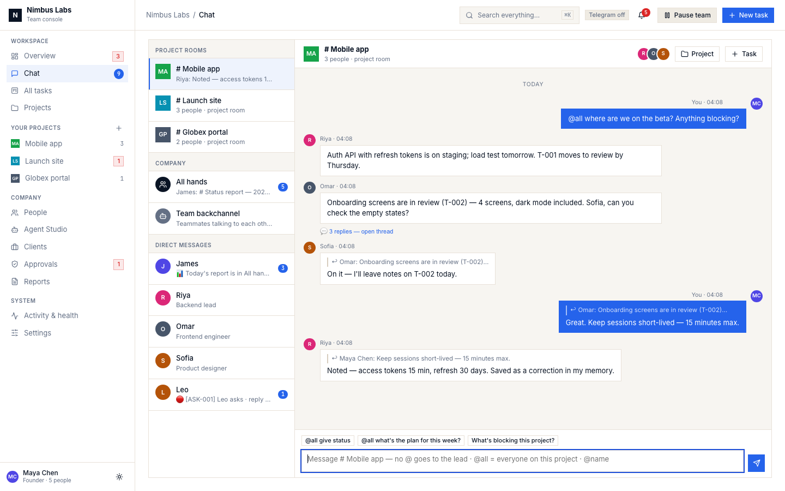 | 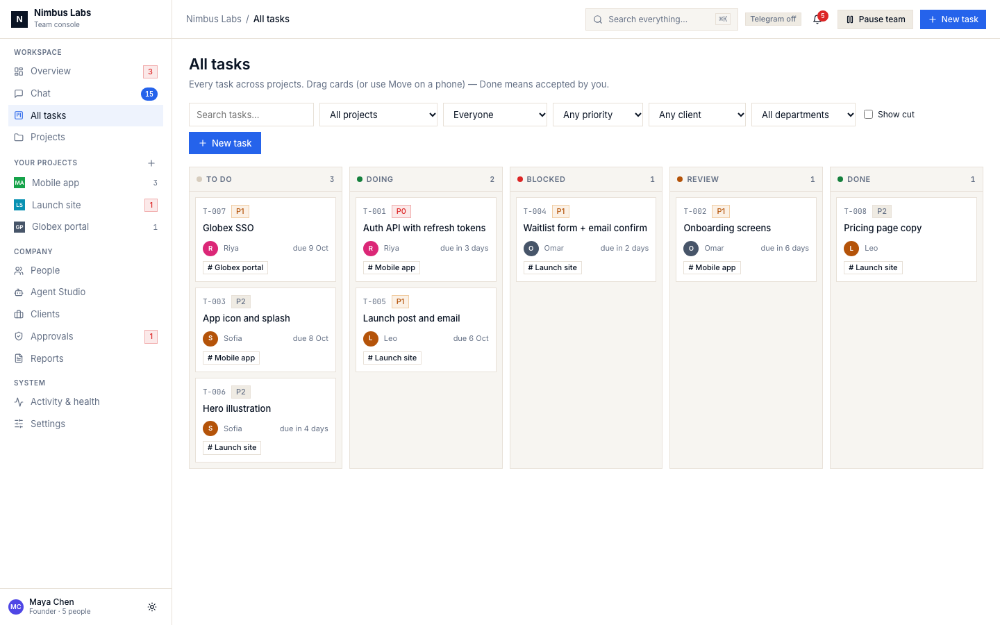 |
| **Project settings** (model, rules, instructions, per person) | **Agent Studio** (templates, persona form, trial chat) |
| 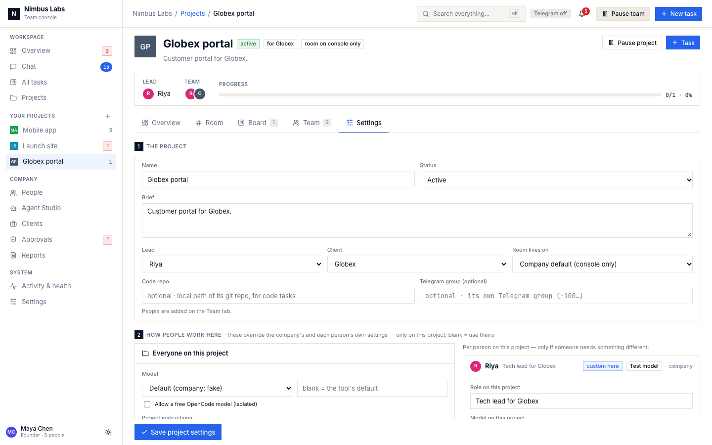 | 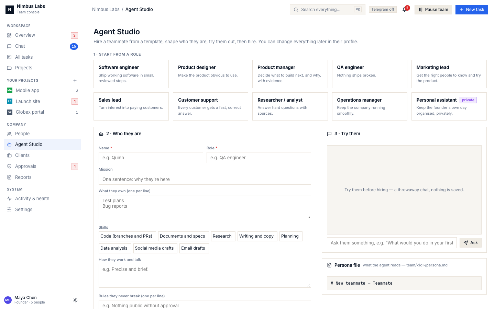 |
| **Approvals** | **Activity & health** |
| 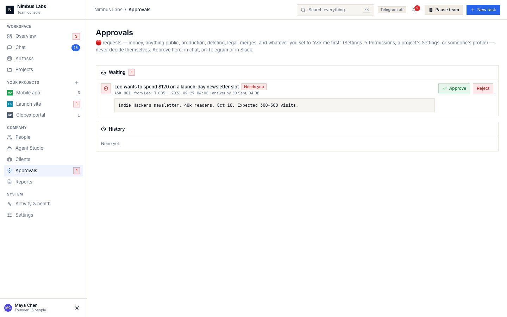 | 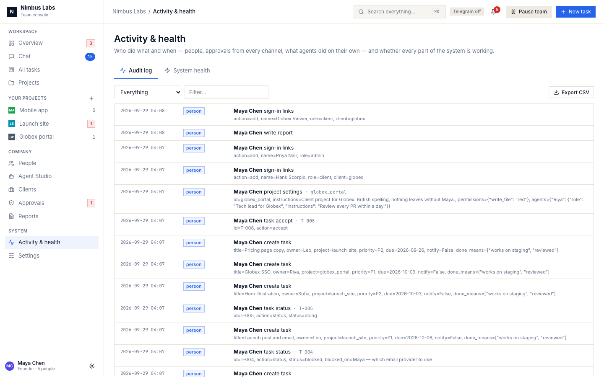 |
| **Settings** | **Client portal** (read only) |
| 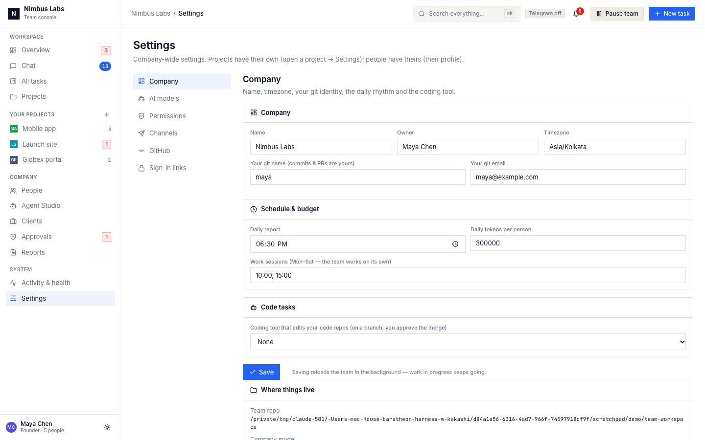 | 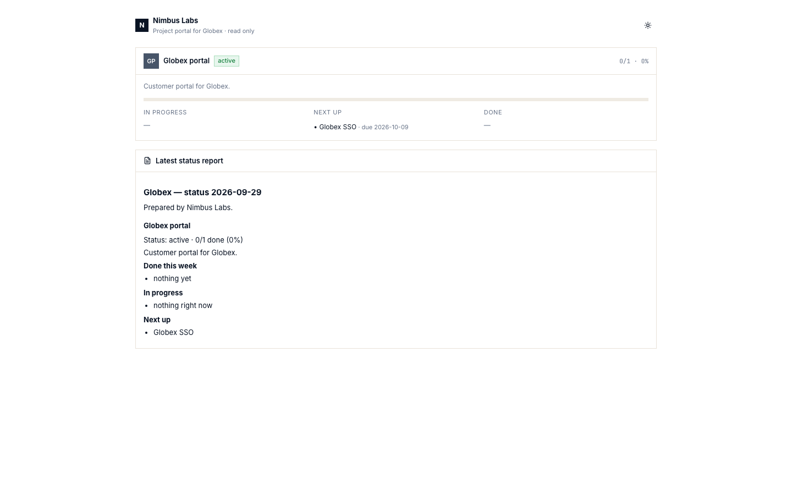 |

<details><summary>Dark theme</summary>

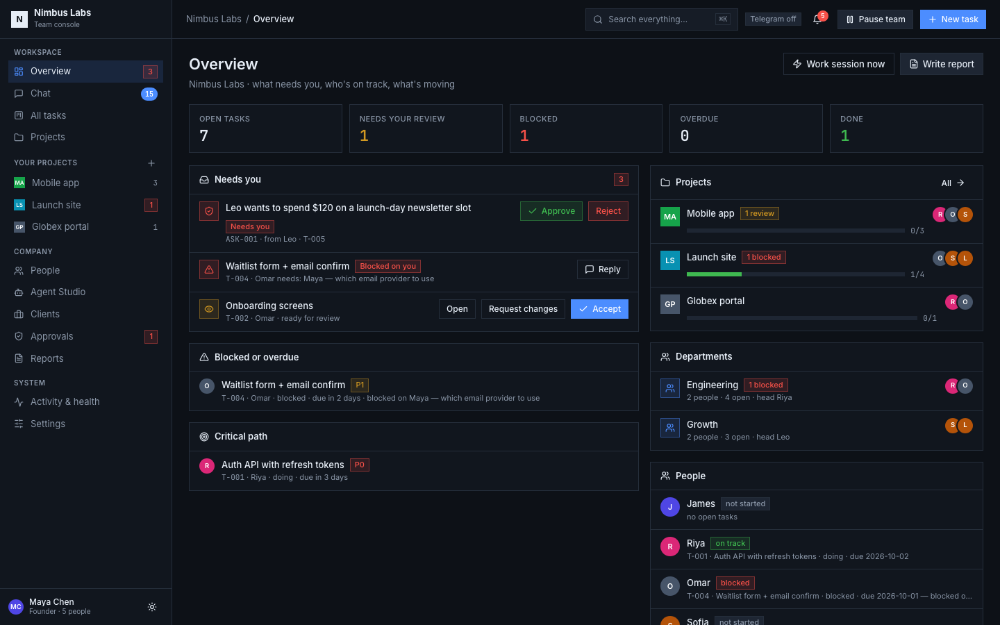

</details>

---

## 🚀 Quick start

```bash
git clone https://github.com/CuriousDevs-AI/james-monitoring.git
cd james-monitoring
python3 -m venv .venv && . .venv/bin/activate
pip install -e ".[all]"

mkdir ../my-team && cd ../my-team
jm run                      # opens the console; setup happens in the browser
```

`jm run` prints a link like `http://localhost:8765/?k=<key>`. The key is how the console knows it's you.
In an empty folder the browser shows **setup**, which covers four things:

1. Your company and your git identity.
2. A model, checked live, with Log in and Test buttons.
3. The team repo.
4. The manager's name.

Then add people: from the **Agent Studio**, by dropping persona files or `SKILL.md` packages onto the People page, or
by hand. Telegram and Slack are optional; everything works in the console.

> **Evaluating local or free models?** Configure Ollama with an installed model, or explicitly opt into an
> available OpenCode free model in Settings. Test the selected model before assigning work. A catalog entry
> is not a capacity guarantee; provider availability and data terms need review. James does not automatically
> switch to a free provider when a paid provider reaches its limit.

### Verify your own deployment

Run checks from the **company folder containing `config.yaml`**, not necessarily the source checkout:

```bash
jm -c /path/to/my-team/config.yaml connection check
jm -c /path/to/my-team/config.yaml doctor
```

These check setup/readiness; they do not prove model inference or message delivery. When approved for your
selected providers, `jm -c /path/to/my-team/config.yaml doctor --ping` makes real model calls (which can consume
quota or incur cost) and checks Telegram bot identity/group membership. It does not send a test conversation
or validate GitHub Projects end to end.

Before enabling recurring work:

1. Test each assigned model with non-sensitive input; check its response, not just its login status.
2. In an approved test group/DM, verify routing, an approval and a rejection. Keep external outreach disabled.
3. On a designated test GitHub board, verify task export and an inbound change requiring human review.
4. Restart and verify saved task/approval state; rehearse [recovery](docs/RECOVERY.md) with credentials
   provisioned separately. Resolve uncertain attempts before continuing.

Keep credentials in local Settings or the configured secret store, never in issues, PRs or chat.

## 📦 Installation

**Requirements**

| | |
|---|---|
| Python | 3.10+ (CI runs 3.10 and 3.12) |
| git | required: the team workspace is a git repo |
| A model | at least one: `claude` CLI, `codex` CLI, `opencode` CLI, an API key, or Ollama |
| Optional | Telegram bots (@BotFather), a Slack app ([docs/SLACK.md](docs/SLACK.md)), the `gh` CLI for GitHub ([docs/GITHUB.md](docs/GITHUB.md)) |

**Extras** (from `pyproject.toml`):

```bash
pip install -e .                 # core (Telegram + YAML)
pip install -e ".[anthropic]"    # + Anthropic API
pip install -e ".[openai]"       # + OpenAI-compatible APIs (OpenAI, OpenRouter, Ollama, vLLM…)
pip install -e ".[slack]"        # + Slack
pip install -e ".[all]"          # everything above
pip install -e ".[dev]"          # everything + pytest
```

The `claude-code`, `codex-cli` and `opencode` providers use their CLIs, which you install separately:
`npm install -g @anthropic-ai/claude-code`, `npm install -g @openai/codex` and `npm install -g opencode-ai`.
You can log in to all three from **Settings → AI models**.

Prefer the terminal? `jm init` is a setup wizard that verifies every Telegram link live; see [docs/SETUP.md](docs/SETUP.md).

## ⚙️ Configuration

Two files sit next to each other in your team folder:

| File | Holds | In git? |
|---|---|---|
| `config.yaml` | company, people, projects, permissions, schedule, channels | no (keep it private) |
| `.env` | secrets: API keys, bot tokens, the console key | no (mode 0600) |

The console edits both for you. Every change is validated and written atomically, and the previous version is kept
as `config.yaml.bak`. A fully commented example is [`examples/config.yaml`](examples/config.yaml), and every
variable is in [`.env.example`](.env.example).

macOS installations can opt into native Keychain storage instead of `.env` for connector credentials.
The owner-only **Settings → Secrets** screen provides explicit status checks and save controls, not secret
reveal. A saved credential is not a verified connection; follow the restart guidance and test the integration.
See [Credential storage](docs/SECRETS.md) for configuration, the owner-only management API and migration limits.
Legacy storage remains the default; nothing is automatically migrated.

<details>
<summary><b>config.yaml at a glance</b></summary>

```yaml
company: Acme Robotics
timezone: Europe/Madrid
owner: { name: Maria Lopez, git_name: maria, git_email: maria@example.com }

llm: { provider: opencode, model: zai/glm-4.6 }        # the company default

monitor:
  daily_report: "18:30"
  work_sessions: ["10:00", "15:00"]                    # Mon–Sat
permissions: { post_group: yellow, run_code: red }     # green | yellow | red

departments: { engineering: { name: Engineering, head: riya } }
clients:     { globex: { name: Globex } }

projects:
  api:
    name: Public API
    lead: riya
    client: globex
    status: active                                      # active | paused | done
    instructions: "British spelling; nothing leaves without Maria."
    permissions: { write_file: red }                    # this project's rules
    agents:
      riya: { role: Tech lead, llm: { provider: claude-code } }   # Riya on this project only

team:
  - { id: james, name: James, role: Delivery manager, monitor: true }
  - { id: riya,  name: Riya,  role: Backend lead, projects: [api], department: engineering,
      llm: { provider: codex-cli } }
  - { id: ada,   name: Ada,   role: Personal assistant, assistant: true }
```

</details>

**How settings combine.** For a person working on a project, the most specific value wins:

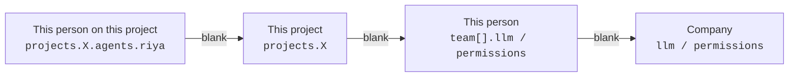

This applies to the **model** and to each **permission**. Project **instructions** and the person's **project role**
are added to the prompt only while they work on that project: in its room, on its tasks, and in work sessions.

### Project resources and task planning

Open a project → **Resources** to add briefs, documents, datasets, designs, artifacts or tool references.
Upload a supported file (up to 2 MB), add notes, and choose whether its readable context goes to assigned agents.
Sheets, Claude and repository links are references, not credentials or automatic integrations. PDF/Office/image
attachments are stored for download, not parsed by AI; include notes or a text export. Keep secrets in Settings → Secrets.

Use **Task** for manual entry or **AI task drafts** for up to 12 proposals based on the project context.
Confirm the selected model, then edit/review each draft before creating it. Tasks become normal scheduled work
only after creation; dependencies still require accepted completion. Planning itself executes no James actions.
Resources are workspace-git files; uncreated drafts live in private runtime snapshots, not GitHub Projects.
See [resource limits, permissions and API](docs/PROJECT-RESOURCES.md).

---

## 🏗 Architecture

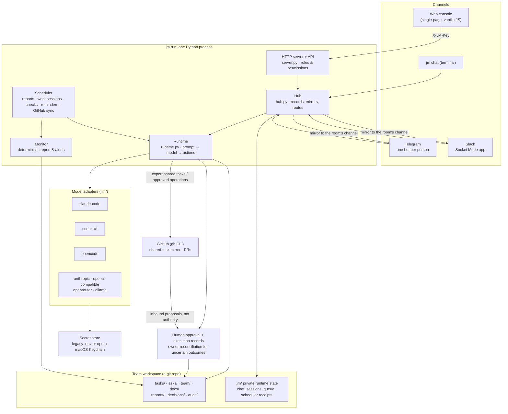

### A message, end to end

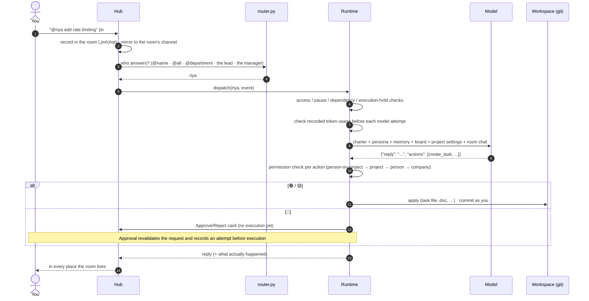

**Design principles** (from [docs/ARCHITECTURE.md](docs/ARCHITECTURE.md)):

1. **Git holds shared work.** Tasks, shared memory, decisions and reports are versioned; private runtime state
   and credentials need separate recovery. GitHub Projects is a mirror, not a complete backup.
2. **Models are replaceable.** Every prompt is built from the files, so a new model gets the same team.
3. **Rooms, not channels.** A room is the same everywhere; a transport is just how you reach it.
4. **Reports come from recorded state.** Deterministic monitoring summarizes evidence; it does not independently
   validate agent-produced work or remote delivery.
5. **Every action is checked.** Agents reply with JSON actions. Each is normalized, permission-checked and applied
   on its own. Failures can receive one repair round with the real results, within the budget/time limits.

## 🧰 Tech stack

| Layer | Technology |
|---|---|
| Language | Python ≥ 3.10 (`asyncio` loop in a background thread) |
| Web server | Standard library `ThreadingHTTPServer`: no framework, no build step |
| Frontend | One file, [`templates/console.html`](james_monitoring/templates/console.html): vanilla JS, CSS design tokens, light and dark themes, Lucide icons inlined (works offline) |
| Storage | git (workspace) + YAML (`config.yaml`) + JSONL (chat, audit) + JSON (runtime state). **No database** |
| Telegram | `python-telegram-bot` ≥ 21 |
| Slack | `slack_sdk` ≥ 3.27 (Socket Mode: no public URL needed) |
| Models | `anthropic` ≥ 0.40 · `openai` ≥ 1.40 · the `claude`, `codex` and `opencode` CLIs |
| GitHub | the `gh` CLI, signed in as you |
| Tests | `pytest` + `pytest-asyncio`, GitHub Actions |

## 🗄 Storage design

There is no database server. State is split by how it should be kept:

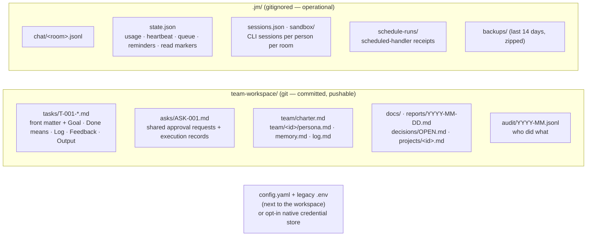

- **Tasks** are markdown with YAML front matter. The ID, owner, status, priority, due date, reviewer and dependencies
  are all readable and diffable, and every change is a commit.
- **Statuses:** `todo → doing → review → done`, plus `blocked` (with "who and what") and `cut`.
- **Chat** is append-only JSONL per room, read incrementally, so the console, Telegram, Slack and `jm chat` stay in
  sync even across processes.
- **Writes are safe.** Writes are atomic (temp file, fsync, rename) and each file has a lock shared across threads
  and processes.
- **Recovery is separate from mirroring.** Snapshot private runtime state and preserve configuration plus the
  workspace git history. Credentials must be recovered separately; ZIP snapshots are not encrypted and do not
  provide a transaction across all live files. See [RECOVERY.md](docs/RECOVERY.md).

---

## 🔐 Authentication, roles and access control

| Who | How they sign in |
|---|---|
| **Founder (owner)** | the console key: `JM_CONSOLE_KEY`, or a random key printed by `jm run` |
| **Everyone else** | a personal link from **Settings → Sign-in links**. Only a SHA-256 of their key is stored, and a new link revokes the old one |

The link's key is sent as the `X-JM-Key` header, and the console removes it from the address bar right away. Keys are
compared in constant time. **Every API route declares the permission it needs** (`GET_PERMS` / `POST_PERMS` in
[`server.py`](james_monitoring/server.py)); anything not listed is refused.

| Permission | owner | admin | member | viewer | client |
|---|:-:|:-:|:-:|:-:|:-:|
| Read the workspace (board, rooms, reports…) | ✅ | ✅ | ✅ | ✅ | — |
| Chat in All hands and project rooms | ✅ | ✅ | ✅ | — | — |
| Read and write the founder's 1:1 rooms | ✅ | ✅ | — | — | — |
| Create and move tasks | ✅ | ✅ | ✅ | — | — |
| Accept, cut, send back, give feedback; approve and reject | ✅ | ✅ | — | — | — |
| Settings, people, projects, models, Studio, memory, audit, health | ✅ | ✅ | — | — | — |
| Sign-in links, reminders | ✅ | — | — | — | — |
| Secret-store management and execution/scheduler recovery | ✅ | — | — | — | — |
| The personal assistant (room, tasks, memory, requests) | ✅ | — | — | — | — |
| Client portal (their projects only, read only) | — | — | — | — | ✅ |

Some rules are enforced beyond the role table:

- Only the founder's own words become binding corrections in an agent's memory.
- Only the founder runs `/commands` or decides approvals from chat.
- Signed-in teammates' messages are recorded under their names, and agents are told they're colleagues, not the
  founder.
- The client report leaves out internal names, chat and costs.

### Agent permissions (what AI teammates may do on their own)

Action types: `create_task` · `update_task` · `write_file` · `message_agent` · `post_group` · `post_room` · `run_code`

| Level | Meaning |
|---|---|
| 🟢 green | just do it |
| 🟡 yellow | do it and tell the founder |
| 🔴 red | becomes an Approve/Reject card holding the action; it runs only after approval (default for `run_code`) |

The charter tells agents to request permission for money, public changes, production, deletion and legal
matters. That instruction is not a universal side-effect detector: enforce supported action permissions in
configuration, and treat arbitrary coding tools as a separate trust boundary. Merge operations through James
always require approval. Project rules apply to actions that touch that project, wherever requested.

## 🧠 AI models

| `provider` | What | Auth | Sessions resume |
|---|---|---|:-:|
| `claude-code` | Claude via the `claude` CLI | Claude Pro/Max login | ✅ |
| `codex-cli` | Codex via the `codex` CLI | ChatGPT login | ✅ |
| `opencode` | any OpenCode model (`zai/glm-4.6`, `anthropic/…`, free `opencode/…` with `allow_free`) | OpenCode provider logins | ✅ |
| `anthropic` | Anthropic API | `ANTHROPIC_API_KEY` | — |
| `openai` | any OpenAI-compatible API | `OPENAI_API_KEY` (+ `base_url`) | — |
| `openrouter` | OpenRouter | `OPENROUTER_API_KEY` | — |
| `ollama` | local models | none (`http://localhost:11434/v1`) | — |

- **Per person, per project.** Set a model in `team[].llm`, in `projects.<id>.llm`, or in
  `projects.<id>.agents.<id>.llm`.
- **CLI sessions** are saved per person per room in `.jm/sessions.json`, so a restart resumes the conversation.
  A fresh session starts when the model changes, or after 40 calls, 600k tokens or 3 days.
- **Reliability.** Temporary failures (rate limits, overload, network) are retried after 3 s and then 10 s. Login
  and key errors aren't retried; they're shown with the fix. A turn is capped at 7 minutes of model calls, and a
  watchdog stops a hung turn after 9 minutes.
- **Restricted CLI execution.** Model calls use scratch directories and an environment allowlist. This is
  not an OS sandbox: same-user files, CLI logins and native credentials can still be accessible.
  - `claude`: no tools and no MCP servers.
  - `codex`: shell, browser, apps and user config are off.
  - `opencode`: an isolated config; paid models have every tool off and every permission denied.
- **Budget, not automatic fallback.** Reported usage is checked before each attempt. A budget-stopped partial
  turn is not automatically replayed, but this is not a hard spending cap. No paid-to-free switch is implemented;
  see [BUDGETS.md](docs/BUDGETS.md). OpenCode free mode is opt-in and does not share the paid path's tool denial.
- **Check a model:** use **Settings → AI models** or run `jm connection check`.

## 🔌 Integrations

| Integration | Setup | Notes |
|---|---|---|
| **Telegram** | Settings → Channels, or `jm init` ([docs/SETUP.md](docs/SETUP.md)) | one bot per person (`TG_TOKEN_<ID>`), the manager's bot reads the group, approval buttons, quiet hours |
| **Slack** | [docs/SLACK.md](docs/SLACK.md) (app manifest included) | Socket Mode, `SLACK_BOT_TOKEN` + `SLACK_APP_TOKEN`, `jm-*` channels per room, `/jm`, approval buttons |
| **GitHub** | [docs/GITHUB.md](docs/GITHUB.md) (`gh auth refresh -s project`) | shared tasks exported; inbound edits require human review; James merge approval is bound to the reviewed commit |
| **Coding agent** | Settings → Company → *Code tasks* | `claude` or `codex` edits the project's repo on a `jm/<task>` branch; you approve the merge |

Each room lives on exactly one outside channel (`sync.channel`, which each project can override). Writing about a
room in the other channel gets a pointer back, and the console always shows everything.

---

## 🖥 CLI

| Command | What it does |
|---|---|
| `jm run [--port 8765] [--host 127.0.0.1] [--no-browser] [--no-telegram] [--no-web]` | start everything: console, team, Telegram/Slack, scheduler |
| `jm init` | terminal setup wizard (verifies Telegram links live) |
| `jm add-member [name --role R --persona FILE --token T]` · `jm remove-member ID` | manage people |
| `jm chat <member\|team\|p-<project>> ["message"]` | talk to someone from the terminal (interactive without a message) |
| `jm status` · `jm report [--write]` · `jm work` | board status · the report · one work session now |
| `jm connection [check\|test\|login claude\|codex\|opencode [provider]]` | check, test or log in to every model |
| `jm doctor [--ping]` | check the setup (models, workspace, personas, Telegram) |

All commands accept `-c path/to/config.yaml` (default `./config.yaml`). In chat (console, Telegram or Slack) the
founder can use `/status` `/board` `/assign` `/accept` `/feedback` `/changes` `/cut` `/asks` `/approve` `/reject`
`/pause` `/resume` `/log` `/budget` `/report` `/work` `/onboard` `/whoami` `/groupid` `/help`.
In Slack, `!status` works like `/status`.

## 🌐 HTTP API

The console uses a JSON API on the same port. Every request needs `X-JM-Key: <key>`. A failure returns
`{"error": "..."}` with 400, 403, 404, 409 (setup needed), 413 or 504. This API exists for the console and
isn't versioned yet; use it at your own risk.

<details>
<summary><b>GET routes</b> (permission in brackets)</summary>

| Route | Returns |
|---|---|
| `/api/state` [any] | company, you (`me`), people, projects, departments, clients, channels (a client gets only their portal info) |
| `/api/dashboard` · `/api/pulse` [read] | the Overview · a cheap poll for unread, versions and "needs you" |
| `/api/tasks` · `/api/task?id=` [read] | tasks you may see · one task with sections, dependencies and git history |
| `/api/chat?room=&after=` · `/api/thread?room=&root=` · `/api/rooms` [read] | messages · a thread · rooms with their last message |
| `/api/asks` [read] | approval requests (the assistant's are the founder's only) |
| `/api/search?q=` · `/api/doc?path=` [read] | full-text search · a team document with history |
| `/api/notifications` [read] | the bell: items with read state |
| `/api/member?id=` · `/api/team` · `/api/project?id=` [read] | profile · people · project detail |
| `/api/project/resources?id=&resource_id=` [read] | project resource metadata; optional single record includes its downloadable file |
| `/api/project/plan?id=` [admin] | saved drafts, planner, selected model and context signature |
| `/api/reports` · `/api/report?name=` · `/api/decisions` · `/api/budget` [read] | reports and decisions · token use |
| `/api/clients` · `/api/client_report?id=` [read] | clients · the client-safe report |
| `/api/models/health` [read] | the setup check shown when the console opens |
| `/api/memory?id=` [admin] | memory entries |
| `/api/settings` · `/api/project/settings?id=` [admin] | company settings · project settings with the effective value per person |
| `/api/models/catalog` · `/api/models/team` · `/api/connections` · `/api/opencode/models` [admin] | every model option · per person · connections |
| `/api/audit` · `/api/audit.csv` · `/api/health` [admin] | the audit log (filters: `kind`, `who`, `q`, `before`) · CSV · system checks |
| `/api/studio/templates` · `/api/github/status` [admin] | Studio templates and skills · `gh` status |
| `/api/model_login` [admin] | the state of a running CLI login |
| `/api/users` · `/api/reminders` [owner] | sign-in links · reminders |
| `/api/secrets` [owner] | credential-store metadata/status, never values |
| `/api/executions` · `/api/schedule/runs` [owner] | unresolved approval attempts · scheduled-run history |
| `/api/portal` [client] | the client's projects and report |

</details>

<details>
<summary><b>POST routes</b> (JSON body; permission in brackets)</summary>

| Route | Does |
|---|---|
| `/api/chat` [chat] | send `{room, text, reply_to?}` |
| `/api/tasks` · `/api/task` [task] | create · `{id, action: status\|edit\|accept\|cut\|feedback\|changes}` (the last four need approve) |
| `/api/ask` [approve] | `{id, decision: approved\|rejected, note}` |
| `/api/ask/reconcile` [owner] | record a verified execution outcome and evidence; never retry |
| `/api/schedule/acknowledge` [owner] | acknowledge a failed/interrupted schedule with evidence; no replay |
| `/api/secrets` [owner] | save a supported credential in the configured store; no reveal |
| `/api/notifications/read` [read] | `{ids}` or `{all: true}` |
| `/api/projects` · `/api/project/members` · `/api/project/settings` · `/api/project/pause` [admin] | project details · team · settings · pause/resume |
| `/api/project/resources` [admin] | create/edit/archive/restore a resource; existing entries require their revision |
| `/api/project/plan/generate` · `/api/project/plan/accept` [admin] | explicit model consent + context signature → drafts; human-reviewed draft → task |
| `/api/member` · `/api/add` · `/api/remove` · `/api/memory` [admin] | profiles · people (removal hands open tasks to the manager) · memory edits |
| `/api/studio/try` · `/api/studio/hire` [admin] | a trial chat (nothing saved) · hire |
| `/api/departments` · `/api/clients` [admin] | save or delete |
| `/api/settings` · `/api/decisions` · `/api/pause` · `/api/work` · `/api/report/run` · `/api/restart` [admin] | company operations |
| `/api/models/assign` · `/api/models/default` · `/api/models/sessions/reset` · `/api/test_model` · `/api/model_check` [admin] | models |
| `/api/model_login` · `/api/model_login/input` · `/api/model_login/cancel` · `/api/model_key` · `/api/connections/*` [admin] | log in to a CLI from the console · save an API key |
| `/api/telegram/*` · `/api/slack/*` · `/api/github/*` [admin] | connect channels and GitHub |
| `/api/upload` · `/api/upload_folder` · `/api/token` · `/api/links` · `/api/member_status` [admin] | import personas · check Telegram bots |
| `/api/users` · `/api/reminders` [owner] | `{action: add\|update\|rotate\|remove}` (the link is returned once) · reminders |
| `/api/setup` [owner] | first-run setup (only while there's no `config.yaml`) |

</details>

---

## 🗂 Project structure

```text
james-monitoring/
├── james_monitoring/
│   ├── cli.py            # `jm` command-line entry point
│   ├── server.py         # console HTTP server, JSON API, roles & per-route permissions
│   ├── templates/
│   │   ├── console.html  # the whole web console (single file, no build)
│   │   └── charter.md · persona.md · manager.md   # starter files for a new team
│   ├── runtime.py        # dispatch, prompts, actions, permissions, sessions, queue, work sessions
│   ├── hub.py            # rooms: record → mirror → route; threads; the runtime's bus
│   ├── router.py         # who answers: @name · @all · @department · lead · manager
│   ├── chat.py           # per-room JSONL chat store (incremental, multi-process safe)
│   ├── prompts.py        # system prompt + action protocol
│   ├── tasks.py · asks.py · mdoc.py   # task board rules · approval requests · markdown+front matter
│   ├── workspace.py      # the git workspace: files, memory, commits, history, state
│   ├── monitor.py        # deterministic report & checks
│   ├── scheduler.py      # daily report, work sessions, checks, brief, reminders, GitHub sync
│   ├── schedule_history.py · backups.py   # durable scheduler receipts · private snapshots and offline restore
│   ├── secret_store.py   # legacy env / opt-in native credential storage
│   ├── config.py · fileio.py   # typed, validated config · atomic writes and locks
│   ├── users.py · audit.py · search.py   # sign-in & roles · audit log · full-text search
│   ├── studio.py · assistant.py          # Agent Studio · personal assistant (reminders, brief)
│   ├── connections.py    # model checks, catalog, console logins (PTY)
│   ├── gateway.py · telegram_setup.py · slack.py · github.py   # integrations
│   ├── executor.py       # coding agent on a branch / worktree; merge after approval
│   ├── setup.py · ui.py · skills.py · commands.py · util.py
│   └── llm/              # claude_code · codex_cli · opencode · anthropic · openai · fake
├── tests/                # pytest + Node form checks; fake transports, model CLIs and gh
├── docs/                 # ARCHITECTURE · SETUP · SLACK · GITHUB · screenshots/
├── deploy/               # Dockerfile · docker-compose.yml · systemd unit
├── examples/config.yaml  # fully commented configuration
├── .env.example
└── pyproject.toml
```

## 🚢 Deployment

**Docker Compose** (the console is published on the host's `127.0.0.1:8765` only):

```bash
cd deploy
mkdir -p data
export JM_CONSOLE_KEY=$(python3 -c "import secrets; print(secrets.token_urlsafe(18))")
docker compose up -d --build
echo "http://localhost:8765/?k=$JM_CONSOLE_KEY"     # finish setup in the browser
```

`deploy/data/` holds `config.yaml`, `.env` and `team-workspace/`. The image includes git and the API providers.
To use the `claude`, `codex` or `opencode` CLIs inside the container, install them in the image and log in there.
Otherwise use an API provider or Ollama.

**systemd:** see [`deploy/james-monitoring.service`](deploy/james-monitoring.service). It runs
`jm -c <data>/config.yaml run` as a dedicated user, with `Restart=always`.

**Remote access:** the console listens on localhost by default. Reach it through an SSH tunnel
(`ssh -L 8765:localhost:8765 server`) or a private network. `--host 0.0.0.0` exposes it to anyone who has the link,
and `jm run` warns you when you do this.

## 🧪 Testing

```bash
pip install -e ".[dev]"
pytest -q                     # simulated providers; local HTTP fixtures need loopback access
```

Install Node.js to run the form checks included by the pytest wrapper; they are skipped if Node is unavailable.
The suite does not require live provider credentials or prove production connectivity.

The tests cover:

- the console backend end to end, the runtime and routing;
- tasks and approvals, roles and access control (over real HTTP);
- the audit log, search, threads, project settings and pause;
- the personal assistant, Studio, retries and the watchdog;
- Telegram and Slack flows (with fakes), GitHub sync (with a fake `gh`), and model CLI adapters.
- execution reconciliation, commit-bound merges, scheduler interruption, secret-store boundaries, backups,
  budget stops and unsuccessful coding results.

CI runs the suite on Python 3.10 and 3.12 for every push and pull request.

## 🛡 Security

- **Local by default.** The server binds `127.0.0.1`. Every API call needs a key, compared in constant time.
  Responses are sent with `no-store`, `nosniff`, `no-referrer` and `X-Frame-Options: DENY`.
- **Credential storage:** legacy `.env` (plaintext, mode 0600) or opt-in macOS Keychain with no environment
  fallback. See [storage boundaries and recovery](docs/SECRETS.md). Sign-in keys are stored only as SHA-256 hashes.
- **Least privilege by role,** enforced on the server for every route (see the table above).
- **Runtime action boundaries, not a complete worker sandbox:**
  - The runtime's file-read action allows only `docs/`, `tasks/`, `reports/`, `team/`, `asks/` and `decisions/`, checked on the resolved
    path, so nothing under `.git`, `.jm` or `.env` is reachable.
  - The runtime's document-write action writes only under `docs/`.
  - Red actions and merges need approval; broad risk classification in a persona is not enforcement.
  - Model CLIs use restricted environments and working directories, not OS isolation. Coding tools and
    same-user credential access need stronger boundaries before running untrusted workers.
- **The audit log** in the team repo records console actions per person, decisions from every channel, agent
  actions and model failures. Secret fields, credentials in URLs and token-shaped strings are scrubbed, and the CSV
  export is protected against spreadsheet formulas.
- **Git** never prompts (`GIT_TERMINAL_PROMPT=0`, SSH in batch mode), never signs, and uses timeouts.

Found a vulnerability? Please report it privately to the maintainers (CuriousDevs, via the contact on the GitHub
organisation) instead of opening a public issue.

## 🗺 Roadmap

Release blockers and acceptance evidence live in [DELIVERY.md](docs/DELIVERY.md). The highest-priority gaps are:

- [ ] Durable background-code outcomes and task holds after executor errors/timeouts/cancellation
- [ ] Complete side-effect receipts, including ungated actions and rejection-triggered PR closure
- [ ] Explicit model fallback policy with approved data destinations and spending boundaries
- [ ] Executor-enforced per-agent/project connector grants
- [ ] Source validation and exact-recipient/content approval with outbound delivery reconciliation
- [ ] Cross-machine recovery and real-account integration acceptance
- [ ] Isolated, tested self-improvement proposals with human review

Additional planned features:

- [ ] Weekly planning and a standup ritual
- [ ] A cost-per-model view in the console
- [ ] Native Slack threads for replies (today a reply is mirrored with a `↩ quote` line)
- [ ] A coding tool per project (today there is one company-wide executor)
- [ ] A versioned public API
- [ ] Validation against real Slack workspaces, Telegram groups and GitHub Projects at scale (these paths are
      covered by tests with fakes)

## 🤝 Contributing

Contributions are welcome.

1. **Fork and branch:** `git checkout -b feature/short-name`
2. **Set up:** `python3 -m venv .venv && . .venv/bin/activate && pip install -e ".[dev]"`
3. **Test:** `pytest -q` must pass. Add tests for new behavior (see `tests/test_workforce.py` for end-to-end style
   tests over the real HTTP API).
4. **Keep the style:**
   - small modules and plain functions;
   - comments that explain *why*;
   - user-facing text in plain, first-person language;
   - no new runtime dependency without discussion;
   - the console stays a single file with no build step.
5. **Open a pull request** describing the change and how you verified it.

For the design, start with [docs/ARCHITECTURE.md](docs/ARCHITECTURE.md). Note that `config.yaml`, `.env` and
`team-workspace/` hold private data and are gitignored.

## 📄 License

[MIT](LICENSE) © 2026 CuriousDevs
