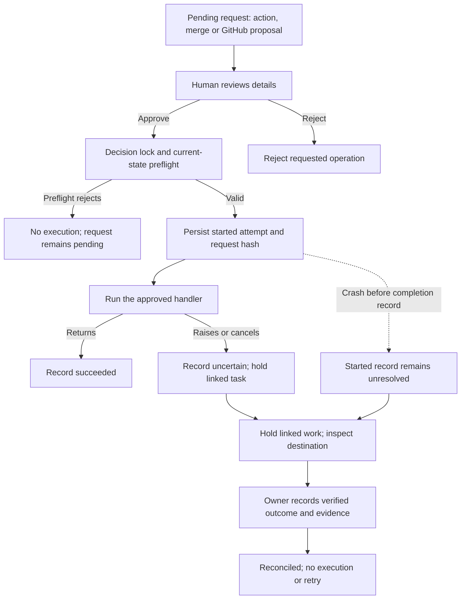
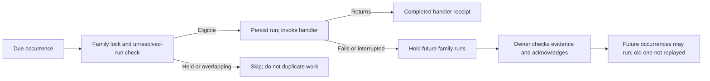

# Architecture

Nothing is specific to one company: names, roles, personas, projects, the manager's name, timezone and
model all come from `config.yaml` and the workspace.

This describes the implemented runtime and its boundaries, not a production-readiness guarantee. Start with
the [README workflow](../README.md#how-work-flows) and [delivery checklist](DELIVERY.md). No diagram below
implies automatic paid-to-free fallback, a complete credential sandbox or exactly-once external delivery.

## Principles

1. **Git holds shared work, not all runtime state.** Tasks, shared memory, decisions and reports are files in
   the workspace repo. Private chats, scheduler receipts and other runtime state live under `.jm/` and need
   separate protected backups. A GitHub Project is a view of shared tasks, not a complete company backup.
2. **Models are replaceable workers.** Every prompt is built from the files, so a new model gets the same team.
3. **Rooms, not channels.** All hands = everyone, a project room = its team, a 1:1 = one person. A room is the
   same in the console, Telegram and Slack; the transport is only how you reach it.
4. **Nothing gets lost in chat.** When the owner corrects someone, the correction is written to the task's
   Feedback and to that person's memory.
5. **The team never waits silently.** Every ask has a deadline and a default. 🔴 asks wait for you, and the
   daily report shows them.
6. **Reports come from recorded state, not generated prose.** They summarize the board; they do not independently
   verify agent claims, external delivery or code quality.
7. **Shared context.** An agent's prompt includes the recent messages of the room it's answering in (everyone's,
   from every channel) and a glance at its other rooms, so a project's people know what was said there.

## Modules

| Module | Role |
|---|---|
| `config.py` | `config.yaml` + `.env` → typed config (times, permissions and per-person models are validated) |
| `fileio.py` | Safe writes: atomic replace, one lock per file across threads and processes, validated config with `.bak`, `.env` add-or-replace |
| `workspace.py` | Git repo layout, commits, memory, logs, runtime state (`.jm/state.json`, not committed) |
| `mdoc.py` | Markdown with YAML front matter + `## Sections` |
| `tasks.py` | Task board and the rules (P0, WIP, done-means, reviewer, blocked-on) |
| `project_resources.py`, `project_plans.py` | Bounded project references/text context; consent-bound, non-executing AI drafts and idempotent human-reviewed task creation |
| `asks.py` | Permission requests, durable execution attempts, decision locks and owner reconciliation |
| `prompts.py` | System prompt = charter + persona + memory + roster + context + action protocol |
| `chat.py` | Rooms (`team`, `p-<project>`, `<member>`, `backchannel`): one JSONL record per room in `.jm/chat/` |
| `hub.py` | Every message goes through here: records it, mirrors it to every channel, routes it to the right people. Also the runtime's Bus |
| `runtime.py` | Dispatch, model call, action application, agent inbox with hop limit, budget, heartbeat, decisions |
| `scheduler.py`, `schedule_history.py` | Scheduled-job receipts, local cross-process exclusion and owner acknowledgment after interruption/failure |
| `secret_store.py` | Explicit legacy environment/native-store selection; credential status and save without reveal |
| `backups.py` | Private atomic snapshots and validated offline extraction into a new directory |
| `executor.py` | Coding CLI in a git worktree on `jm/<task>`, merge after approval |
| `runtime.run_work_session` | Scheduled work: each member with todo/doing tasks moves the top one; digest to the owner |
| `monitor.py` | Deterministic report and checks (overdue, blocked too long, asks past deadline, failures) |
| `router.py` | Who answers: `@all`, `@name`, `@bot_username`; project rooms default to the lead, All hands to the manager |
| `gateway.py` | Telegram transport: one bot per member, the manager reads groups, approval buttons |
| `github.py` | Shared tasks mirrored into GitHub; inbound edits become human review requests, verified account comments are deduplicated, private tasks excluded; PRs via `gh` |
| `slack.py` | Slack transport: one app (Socket Mode), everyone posts as themselves, channel ↔ room mapping, approval buttons |
| `commands.py` | Owner commands, shared by Telegram and `jm chat` |
| `llm/` | `claude-code`, `codex-cli`, `opencode`, `anthropic`, `openai` (OpenAI-compatible endpoints) and `fake`; model selection per company/person/project, not automatic failover |
| `setup.py` | `jm init` wizard, `jm add-member`, persona import |
| `users.py` | Sign-in links and roles (owner, admin, member, viewer, client); only SHA-256 hashes of the keys are stored |
| `audit.py` | The audit log in the team repo (`audit/YYYY-MM.jsonl`): console actions per person, decisions from every channel, agent actions, model failures, stuck turns. Secrets never written |
| `search.py` | Full-text search over every room, task, document and memory entry — only what the viewer may see |
| `assistant.py` | Personal assistant mode: reminders (`remind` action), the morning brief |
| `studio.py` | Agent Studio: role templates, skills, the persona form (and back) |

## The action protocol

Every model reply is one JSON object: `{"reply": "...", "actions": [...]}`. The runtime checks and applies
each action:

`create_task` · `update_task` · `write_file` (docs/ only) · `read_file` (docs, tasks, reports, team, asks, decisions; up to 2 read rounds) · `ask_permission` · `remember` · `message_agent` · `notify_owner` · `post_group` · `post_room` · `run_code` · `remind` (the personal assistant only)

Each action is normalised (wrong types fixed where possible) and applied on its own: one bad action is reported
(⚠️) and the rest still run. If any failed, the agent can receive **one repair round** with the exact results,
subject to budget/time limits. Results are kept in history as evidence, not as a guarantee that the model will
interpret them correctly. A reply that isn't JSON, or was cut off at
the output limit, gets one retry that says what went wrong. Long documents go *after* the JSON in
`<<<FILE docs/…>>> … <<<END>>>` blocks, so they can't break it.

History is kept per person **per room**: approval follow-ups, work-session notes and your DMs are one thread.

Before an action runs, its permission level is checked (`permissions` in config, overridable per person):
🟢 runs; 🟡 runs and the owner gets an FYI; 🔴 becomes an ask of kind `action` holding the action itself. When the
owner approves (console, Telegram or Slack), the runtime runs that action for the agent. Rejected actions never run.
Before recording an action approval, the runtime checks that the requesting agent still exists, the action
type is supported, and the agent can still access both the action's task and the originating event's task.
New requests retain the event task separately; older requests use their existing stored task reference.
These checks and the dependency preflight leave invalid requests pending, so they can be rejected or repaired.
Approved action, merge and GitHub-proposal requests persist a single execution attempt and hold uncertain task-linked work for owner
reconciliation. See [EXECUTION.md](EXECUTION.md) for the recovery API and remaining coverage gaps.

`message_agent` hand-offs (and the reply) are recorded in the project's room, or in the backchannel when no
project is involved, as `internal` messages. The owner can see how the team coordinates.

## Why agents don't talk through Telegram

Telegram bots never receive messages sent by other bots. So agent-to-agent messages go through the runtime:
they're logged to `team/<id>/log.md`, visible with `/log`, and capped by `limits.max_agent_hops`.

## Reliability

- **Scheduled outcomes** are recorded before and after each scheduler-owned handler. Failed/interrupted
  families wait for owner acknowledgment; a handled occurrence is never automatically replayed. See
  [SCHEDULER.md](SCHEDULER.md) for recovery endpoints, retained private receipts and deployment limits.
- **Console shutdown** stops intake and scheduler/transports, cancels and awaits remaining async tasks,
  and joins the app loop and executor threads. Coding-run cancellation kills its subprocess group.
  Blocking model calls still depend on their provider/CLI timeouts; a close timeout is reported as still
  shutting down, not as success. This cleanup does not make interrupted external actions replay-safe.
- **Credential storage**: legacy `.env` or explicit opt-in macOS Keychain, selected per configuration. Native
  reads never fall back to environment values and native writes never export values into the environment.
  Model probes keep temporary credentials local to that probe; coding executors use the CLI environment
  allowlist. See [SECRETS.md](SECRETS.md) for setup, the owner-only metadata/save API, migration limitations,
  same-OS-user exposure and the remaining credential-broker work.
- **Task dependencies** are validated on creation and editing (missing references, self-dependencies and new
  cycles are rejected). Only `done` satisfies a prerequisite; `review`, `cut` and missing task files do not.
  Work sessions skip tasks with unfinished prerequisites and skip paused/completed projects. Status changes
  to doing/review/done, task-linked document writes, coding starts and merge approvals recheck prerequisites.
  Action approvals retain their originating task and remain pending if that dependency preflight fails.
  A task-ID blocker clears only when all named and declared prerequisites are done. Other human blockers
  are not cleared just because a declared dependency finished. Remove an obsolete dependency explicitly.
  Unrelated one-off requests remain available. These are runtime checks, not an OS sandbox or a transaction
  spanning a remote merge; in-flight work and cross-process races still need the durable execution layer.
- **config.yaml**: every change is read-modify-validate-write under one lock, with a `.bak`. A reload builds the new
  runtime first and swaps it in one step. The old one's work in flight continues, sharing the per-person locks.
- **git**: one lock per repo (threads and processes), no prompts (`GIT_TERMINAL_PROMPT=0`, SSH BatchMode), no
  signing, timeouts, and pushes in the background. A failed commit is recorded and alerted; it never breaks a reply.
- **Merges** have an execution attempt before git runs. Failed/interrupted attempts require owner
  reconciliation, not another approval click, even if local conflict rollback succeeded. Cancellation keeps
  the decision lock until the git worker has stopped. See [EXECUTION.md](EXECUTION.md).
- **Agents read files** only under docs/tasks/reports/team/asks/decisions, checked on the resolved path. Nothing under
  `.git`, `.jm` or any `.env` is readable.
  Personal-assistant team files, tasks and asks additionally require the owning assistant's identity. Private
  task dispatch/mutation is denied to other agents. Private asks are omitted from shared reports and agent context;
  monitoring alerts go to the assistant's founder DM, not the manager or group. Sharing an assistant's output
  through documents, code, team messages or shared task creation requires explicit human approval.
- **GitHub changes** are proposals, not evidence of founder authority. Board snapshots have no editor identity.
  Comments must originate from the authenticated human `gh` account and still need a separate human decision.
  Raw GitHub proposal files are not exposed to agent file reads; approved feedback is delivered through the task.
  Review rejects changes when the relevant field, task owner/project or connection scope no longer matches.
  Comment cursors advance after proposals are persisted; comment IDs prevent replays after decisions.
  Approved proposals now have execution receipts; this is not full cross-project data isolation. Previously exported
  private issues and historical shared artifacts require separate review; this upgrade does not delete them.
- **Telegram**: edits never re-trigger work, messages are handled once, 429s are waited out, supergroup upgrades are
  followed (and saved), and a bot that fails to start never leaves others polling.
- `.jm/` (chats, conversation memory, state, scheduler receipts) is zipped daily into `.jm/backups/` (last 14).
  New snapshots are private (0600), atomically replaced, and exclude symlinks/sandbox/locks/env files.
  Offline extraction only targets a new directory and starts no services; see [RECOVERY.md](RECOVERY.md).
  ZIP is not encryption, and live daily snapshots are not cross-file transactional checkpoints.
- **Model CLIs use restricted working directories and environments.** Each call starts in a scratch folder
  with the configured environment allowlist; timeouts kill its process tree. This is not an OS sandbox:
  same-user files, CLI logins and native credentials can remain accessible. See [SECRETS.md](SECRETS.md).
  - `claude`: no tools, no MCP servers, no user settings or hooks.
  - `codex`: shell, browser, apps, MCP and user config are off, so it can't read files.
  - `opencode`: empty isolated config (no global MCP servers or plugins); paid models get all tools off and every
    permission denied. Free models are opt-in (`allow_free`) and use a throwaway home.
- **One turn is bounded** (7 minutes of model calls), so nobody's lock is held for long. Pause means paused for
  everything, including system follow-ups, which are queued.
- **Only the founder's own words become pinned corrections** in memory. A teammate's message, a document or a
  GitHub comment can't make itself binding.
- **Temporary model failures are retried** (rate limit, overload, network: after 3s, then 10s, within the turn's
  time). Login, key and model errors aren't retried; they're shown with the fix.
- **Reported token usage is checked before each model attempt**, including read/repair follow-ups. A partial
  turn stopped by the budget is not queued for replay. This is not a hard spending cap or automatic provider
  fallback; see [BUDGETS.md](BUDGETS.md).
- **Failed coding commands are not merge-ready.** Their working branch remains available for inspection,
  their task is blocked, and no PR/merge approval is created when the executor returns an unsuccessful result.
  Exceptions/timeouts and cancellation do not yet apply that same task hold; see [EXECUTION.md](EXECUTION.md).
  A command's successful exit is not proof of tests.
- **A hung turn is stopped** by the hub's watchdog (turn limit + 2 minutes). The person says so in the room, the
  lock is released, and it shows in Activity & health.
- **Activity & health** (console) checks the engine, scheduler, git, disk, models, channels, replies in progress,
  the queue and overdue approvals.

## People, roles and privacy

The founder opens the console with the key `jm run` prints. Everyone else gets a personal link from
Settings → Sign-in links; each has a role:

| Role | Can |
|---|---|
| admin | everything except making sign-in links (settings, people, models, approvals) |
| member | read; talk in All hands and project rooms; create and move tasks (not accept or cut) |
| viewer | read only |
| client | only the client portal: their projects' progress and a client-safe report |

Every API route declares the permission it needs (`GET_PERMS` / `POST_PERMS` in `server.py`); anything else is
refused. Messages from signed-in people are recorded as them, and agents are told they're a colleague, not the
founder. Only the founder runs commands or decides approvals in chat.

Private by design: the founder's 1:1 rooms (admins can see them), and everything of the **personal assistant**
(`assistant: true`): its room, its tasks, its reminders. It's left out of @all, the roster, the company report and
teammates' `message_agent`.

**Departments** (`departments:`, `team[].department`) group people with a head; `@engineering` reaches a whole
department in All hands; the report has a section per department. **Clients** (`clients:`, `projects.<id>.client`)
get a report built from the files (only their projects, no internal names, no chat) and, if you want, a portal
login.

## Project settings

A project can have its own model, rules and instructions, for everyone on it or per person. These apply when
someone works on that project: in its room, on its tasks and in work sessions.

```yaml
projects:
  website:
    llm: {provider: opencode, model: zai/glm-4.6}      # everyone on this project
    permissions: {write_file: red}                      # the project's rules
    instructions: "Client is Globex. British spelling."
    agents:
      riya: {role: Tech reviewer, instructions: "Review every PR within a day.",
             llm: {provider: claude-code}, permissions: {write_file: green}}
```

The most specific setting wins: this person on this project, then the project, then the person's own, then the
company's. The project's Settings tab shows who ends up with what, and where each value comes from. Project models
are checked by the AI setup check and health, and sessions reset when the model changes.

## Threads

A reply keeps `reply_to` (the message it answers), `thread` (the thread's first message) and a short quote. Whoever
you reply to answers (unless you @mention someone), inside the thread, and the agent sees the quote. Telegram
swipe-replies bring their quote in; Telegram and Slack show a `↩ quote` line on replies.

## One conversation, every channel

```
console ──┐                          ┌── console (reads .jm/chat)
Telegram ─┼─► hub.receive(room) ─────┼── Telegram (skips what it sent)
Slack ────┘   hub.handle → route ───►└── Slack
                     │
                     ▼ room_targets → runtime.dispatch(member, Event(room=…)) → hub.post(room, reply)
```

`sync.mirror_owner` (default on) also shows the owner's own messages in the other channels ("🗨 Pankaj (via console): …").

## Execution and recovery flow

### Approved actions, merges and GitHub proposals



The diagram covers the approval handler, not every child operation. `run_code` handler success means the
background task was started. Rejection-triggered PR closure and green/yellow effects do not yet have equivalent
execution receipts. A held request cannot be approved again; reconciliation records evidence, not a retry.
Checks inside a started handler, such as the executor rejecting a changed merge head, take the conservative
uncertain-outcome path even if no merge happened. Do not confuse these with preflight rejection before a receipt.
Detailed boundaries and endpoints: [EXECUTION.md](EXECUTION.md).

### Scheduled work



A completed work-session handler may still have background coding in flight. Scheduler receipts do not replace
code-run or provider-delivery receipts. Locks coordinate local POSIX processes, not multiple hosts. See
[SCHEDULER.md](SCHEDULER.md).

### Coding example: "Riya, add rate limiting to the API"

1. Route the DM to Riya. Check access, project state and recorded usage; build context from her persona,
   memory, board and relevant project settings.
2. The model can propose a task and `run_code`. The default `run_code: red` creates an approval request;
   it does **not** immediately start the executor. Task scope, dependencies and execution holds are rechecked.
3. After approval, record the attempt and start the configured coding CLI in a task worktree on `jm/<task>`.
   The approval receipt confirms startup only. There is one company-wide coding command today.
4. On a returned failure result, retain the branch, block the task and create no PR/merge ask. On successful
   exit with no changes, report that result. On successful exit with changes, optionally open a PR and create
   a separate red merge request containing the full reviewed commit SHA. The task moves to `review`.
5. The human inspects the diff and actual test evidence. Merge approval rechecks dependencies and the reviewed
   commit. A local merge uses that exact commit; a GitHub merge uses the expected head SHA and requires a
   completed-merge receipt. A changed head is refused, not silently approved.
6. A successful merge can mark the task done. Failed/interrupted merge attempts need owner reconciliation,
   not a second click. Neither a code-command exit nor a merge means production deployment or acceptance
   testing happened automatically.

Caught executor exceptions/timeouts and coding cancellation now create an uncertain `code_recovery` request,
block the task and survive restart. The existing scheduler/dispatch/action guards refuse that task until owner
reconciliation. This is not a pre-start code-run ledger: abrupt process termination before recording the hold
can still leave unfinished work without a receipt. Final code-run receipts remain required.

### GitHub persistence and review

Shared task files remain the engine. Sync exports them to the configured issue repository and Project;
inbound edits become human-reviewed proposals, not direct instructions. A separate GitHub Project is not
automatically created for each James project. Private-assistant tasks are excluded from the mirror.

Preserve three things independently: workspace history, private runtime/configuration backups, and credentials
provisioned through the chosen store. A Project board cannot reconstruct the company after local data loss.
See [GITHUB.md](GITHUB.md), [RECOVERY.md](RECOVERY.md) and [SECRETS.md](SECRETS.md).
